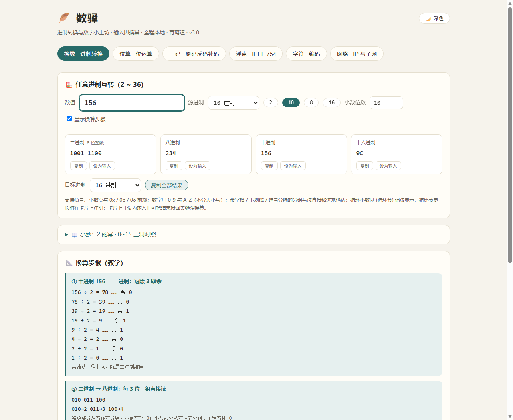
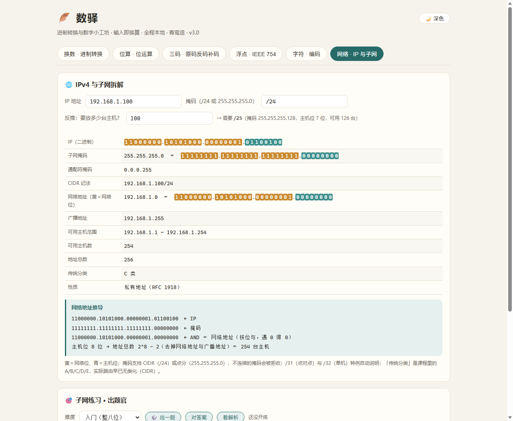

# 数驿 · Num Station

> 进制转换与数字小工坊——单文件、零依赖、离线即用的本地网页工具。
> A single-file, dependency-free, offline web tool for number-base conversion and learning.

数驿把 2~36 任意进制互转、位运算、原码/反码/补码、IEEE 754 浮点拆解、字符编码、IPv4 子网计算装进一个约 80 KB 的 HTML 文件，换算附带短除法／按权展开／乘基取整等教学步骤——既是日常换算工具，也是进制学习的教具。



## 特性一览

| 面板 | 能做什么 |
|---|---|
| 换数 | 2~36 进制互转（整数＋小数）、循环节检测、BigInt 精确运算、千位分组、教学步骤演示 |
| 位算 | AND/OR/XOR/NOT、移位（含算术右移）、popcount、补码位级展示 |
| 三码 | 原码／反码／补码推导与回读，附推导步骤 |
| 浮点 | IEEE 754 单/双精度拆解（符号／指数／尾数）、浮点反查 |
| 字符 | UTF-8／GBK 编解码、码点查看，不合法字节明确警示 |
| 网络 | IPv4 子网拆解（网络／广播／可用主机数）、AND 推导、主机数反推前缀 |

**练习向**：子网出题官与转制出题官（三档难度，负数与小数题型），判卷容错（千位分隔／大小写／等值小数）；答错自动进错题本（仅存本机 localStorage），可再练销账、看累计战绩。



**体验向**：深色／浅色／跟随系统三态主题、键盘流（数字键 1-6 切面板、Enter 提交）、读屏实时播报（aria-live）、WCAG AA 对比度、打印样式、尊重 prefers-reduced-motion。

## 快速开始

1. 从 [Releases](../../releases) 下载 `num-station.html`（或直接下载仓库中的 `数驿.html`）；
2. 双击用浏览器打开——Edge／Chrome／Firefox 均可；
3. 输入即换算，全程本地计算，无安装、无联网、无依赖。

## 自测三件套

仓库附带开发期沉淀的三通道自测，改完代码跑一遍即可回归：

```bash
node 自测-核心.js   # 153 组核心断言（含 15,200 例进制往返 fuzz 不变量）
node 结构自检.js    # 20 项结构交叉核对（id 唯一性、标签平衡、版本一致等）
node 真机自测.js    # 98 项 headless Edge 真机断言（需 Windows + Edge）
```

## 安全与隐私

- 全程本地计算，页面 CSP 锁为 `default-src 'none'`，不发任何网络请求；
- 错题本与主题偏好仅存浏览器 localStorage，不上传、不同步；
- 无第三方代码、无构建步骤、无遥测。

## License

[MIT](LICENSE)

---

数驿 v3.0 · 2026-11 · 青鸾造 🪶
